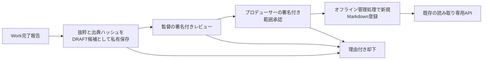

# ZCS-OS-012｜Studio Memory候補・承認・登録（DRAFT）

この実装はDraft PR #9から分岐した隔離ブランチの**オフライン管理経路**である。既存のFastAPI Reader、Work別短命トークン、非公開Markdown形式を再利用する。既存OS、MASTER、正式記憶保管庫は更新していない。AIの候補提出を人間の判断と混同しない。

## 状態と承認境界

| 登録ワークフロー状態 | 必要な操作 | 正式記憶への影響 |
| --- | --- | --- |
| DRAFT | Workの報告から原文一致の抜粋を提案 | なし |
| DIRECTOR_REVIEWED | 監督専用のEd25519秘密鍵で署名した審査票 | なし |
| PRODUCER_APPROVED | プロデューサー専用のEd25519秘密鍵で署名した審査票 | 登録待ち |
| REGISTERED | 署名と出典を再検証し、未使用IDのMarkdownを新規作成 | Readerから取得可能 |
| REJECTED | プロデューサーの理由付き署名 | 登録不可、履歴保持 |
| REVOKED | 登録後のプロデューサー理由付き署名 | 現行Readerから除外し、原文を私有アーカイブへ保存 |

これらは既存ノートの`approval_status`とは別の状態である。候補は常に`approval_status: DRAFT`で始まる。登録時の`approval_status`はプロデューサーの署名した値を使い、`approval_scope`は候補と厳密一致する。例えばSNS公開のみの承認を本編MASTER承認に拡張できない。登録自体も全面承認を意味しない。

## 非公開保存と出典

候補JSONは私有`candidates/`、署名と履歴は`events/`、登録前後の本文差分は私有`diffs/`、取消後の原文は`archive/`に保存する。監査イベントに記憶本文・報告本文・資格情報は保存しない。候補は完了報告ファイルの原文と一致する判断・理由の抜粋を要求し、ファイルのSHA-256と絶対パスを私有候補に記録する。不明値は`未確認`とし、未確認の判断・理由・承認範囲が残る候補は承認できない。チャット履歴の自動収集はしない。

登録時は元報告の存在とハッシュ、抜粋一致、ノートIDの未使用、関連記憶の実在、既存ノートとの表題・素材ID・キャラクター名の重複を確認する。検出した重複はプロデューサーが署名票内で該当IDを明示しなければ登録を拒否する。これは保守的な機械検査であり、意味上の矛盾を網羅するものではない。関連IDや出典の意味上の妥当性は監督とプロデューサーが判断する。Markdownは既存Readerのパーサーで事前検証し、既存ノートを上書きしない。登録は隠れた一時ファイルを作った後に履歴を記録し、最後に新規名として公開する。途中障害ではReaderに未記録のノートを見せず、人手での復旧が必要になる場合がある。

## 管理者・人間レビューの手順

実行場所は`backend`。OpenSSL 3（このMacでは`/opt/homebrew/opt/openssl@3/bin/openssl`）を使用する。必要なら`STUDIO_MEMORY_OPENSSL`で実行ファイルを指定する。

1. 管理者がGit外の隔離保管庫・ワークフロー領域を準備する。監督・プロデューサーの**公開鍵のみ**をWork側へ渡す。秘密鍵はWork環境、Git、チャット、ログへ置かない。
2. `.venv-reader/bin/python -m tools.memory_workflow --root <私有作業領域> init --vault <隔離記憶保管庫> --director-public <監督公開鍵> --producer-public <プロデューサー公開鍵>`で初期化する。
3. 完了報告を選び、`--fields <選択情報JSON>`と`--report <報告ファイル>`を使って`propose`する。JSONの`decision_excerpt`と`reason_excerpt`は原文から正確に抜粋する。`status --id <記憶ID>`でDRAFTを確認する。
4. `packet --id <記憶ID> --action DIRECTOR_REVIEWED --actor <監督名> --out <審査票>`で署名前の正規JSONを作る。監督は内容と出典を確認し、Workから隔離された秘密鍵で`openssl pkeyutl -sign -inkey <監督秘密鍵> -rawin -in <審査票> -out <署名>`を実行する。Work側は`apply --assertion <審査票> --signature <署名>`で公開鍵検証する。
5. 同様に`PRODUCER_APPROVED`の審査票を作り、必要な`--approval-status APPROVED`と承認範囲をプロデューサーが確認する。プロデューサー専用鍵の署名が通った候補だけ`register --id <記憶ID>`で新規登録する。署名票は24時間で失効し、順序違反や再適用を拒否する。
6. 却下は理由付き`REJECTED`署名票、登録後取消は理由付き`REVOKED`署名票を使う。取消は現行ノートを私有アーカイブへ移し、履歴は残す。

一般Workの`STUDIO_MEMORY_AUTH_DIR`短命閲覧資格情報では審査署名を作れない。プロデューサー秘密鍵をAIが読める環境に配置すると、この境界は成立しない。実運用前に人間の鍵保管・紛失時の失効・端末分離手順を決める必要がある。今回、実鍵は作成・使用していない。

## Work 02連携と検証範囲

Work 02が提示した実際のEP00ユナ5秒r03制作結果報告をWork 01が確認し、原文抜粋とSHA-256付きの**DRAFT候補**を非公開のローカル成果物に保存した。候補IDは`WORK02-EP00-R03-001`。技術PASSと演出・作画REWORKを混同せず、正式採用・MASTER・公開承認を含めていない。監督署名、プロデューサー署名、正式保管庫登録は行っていない。承認後の登録・Reader再取得は合成データだけで検証した。

合成データテストでは、DRAFT作成、監督レビュー、プロデューサー承認、Markdown登録、Reader検索・詳細、出典追跡、理由付き却下・取消、署名不正、承認順序違反、期限切れ署名、出典改変、ID重複、範囲拡張、既存ノート上書きを検査する。ZCS-OS-010/011のReaderテスト、フロントエンドテスト、ビルドを回帰確認する。

## 残課題

- 公開鍵の運用と本人確認は人間の管理に依存する。同一macOSユーザーがWorkと人間秘密鍵の両方へアクセスできる構成では、人間承認の独立性を保証できない。
- 出典ファイルのハッシュ一致は原本性を保証するが、報告そのものの真実性や意味上の矛盾は自動判定できない。
- 現行登録は**新規IDのみ**。既存記憶の改稿は無断上書きを避けるため実装せず、別IDと関連リンクで提案する。差分ファイルは新規登録の空状態→新本文を保管する。
- 複数管理者の同時操作、障害直後の中断処理、外出先管理、鍵のローテーションは次段階。公開・本番利用はしない。
