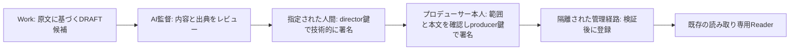

# ZCS-OS-013｜承認者認証・鍵管理（隔離検証版）

本書は運用開始の承認ではない。Draft PR #8（閲覧）、#9（記憶Reader）、#10（候補ワークフロー）を前提にした追加実装であり、既存PR・本番OS・MASTER・実制作記憶を変更しない。署名テストには合成鍵と合成候補だけを使う。

## 権限境界

AI監督の品質判断と、director鍵を使う**人間の署名行為**は別である。director鍵の保持者・本人確認手順は未指定で、プロデューサーが決定する。producer鍵は本人だけが操作し、Workの閲覧トークンやCLIに秘密鍵を渡さない。署名票の`actor`文字列だけでは本人性を証明しない。鍵の占有と別OSセッションでの操作確認が前提となる。署名者が内容を見ずに機械的に署名すれば制度は成立しない。

## 鍵保管候補

| 方式 | Workからの隔離 | 本人の操作 | Ed25519署名との接続 | 失効・復旧 | 費用・負担 | 判定 |
| --- | --- | --- | --- | --- | --- | --- |
| 同じmacOSユーザーのキーチェーン | 設定次第。同一ユーザーのWorkに取得・署名要求をさせ得る | 毎回確認を要求する設定は可能 | 専用の署名プログラムが必要。今回未実装 | 鍵の書き換え・保管を運用設計する必要 | 追加費用なし、設定負担中 | **単独では不採用** |
| プロデューサー専用の別macOS標準ユーザー | Workに管理者権限・そのユーザーのログイン権限を与えない限り分離できる | 本人が別ユーザーへ切替えて審査票を確認 | OpenSSL Ed25519の既存実装を利用可 | 公開鍵更新と秘密鍵のオフライン保全が必要 | 追加費用なし、毎回の切替えが必要 | **初期推奨** |
| ハードウェア認証器／外部署名環境 | 秘密鍵をWork端末から分離しやすい | PIN・タッチ等を要求できる製品がある | 製品・ファームウェアと署名APIの個別検証が必要 | 予備鍵・失効計画が必要 | 機器購入や連携実装が必要 | 将来候補、今回は購入しない |

Appleのキーチェーンはアプリ単位の許可や毎回確認を設定できるが、同じログイン主体にあるWorkからの隔離をそれだけで保証しない。別ユーザー案も、Workが管理者権限や画面操作権を持つなら成立しない。ハードウェア案のEd25519対応は機種とファームウェアに依存するため、製品選定前に互換試験が必要。

**初期推奨**：専用の標準macOSユーザーに秘密鍵と私有ワークフロー領域を置き、Workからは未署名候補と公開鍵だけを受け渡す。承認操作はプロデューサー本人がそのユーザーで行う。director鍵は別の指定された人間／セッションに置く。公開鍵を変更する際はproducer鍵で管理票に署名する。Workは鍵保管領域へのアクセス権・sudo権を持たないことを実環境で確認してから運用開始する。現行の開発用macOSユーザーには広いファイル権限があるため、**現時点の隔離テストだけで本人承認を保証できない**。

参考： [Appleのキーチェーンアクセス制御](https://support.apple.com/en-gb/guide/mac-help/kychn002/26/mac/26)、[Appleのユーザー分離](https://support.apple.com/en-ie/guide/mac-help/mchl3e281fc9/27/mac/27)、[YubicoのPIV対応表](https://docs.yubico.com/hardware/yubikey/yk-tech-manual/yk5-apps-piv.html)。

## 実装した最小変更

- 公開鍵に役割別の鍵ID（公開鍵SHA-256由来）を与え、`keys/registry.json`にactive/revokedを保存。旧公開鍵は履歴検証のため保持する。
- 審査票は候補JSON、出典、本文要素、承認範囲、使用鍵ID、生成時刻、使い捨てnonceを署名対象に含める。署名票は24時間で失効する。`packet`は正規JSONと**同一assertion**を表示した`.review.json`を対で出力する。人間は表示内容と正規JSONのハッシュを照合してから署名する。
- 監督→プロデューサーの順序を強制し、別鍵・改変・期限切れ・使用済みnonce・失効鍵を拒否する。producer鍵が承認後に失効した場合は登録を止め、再審査を求める。
- director鍵の失効、両役割のローテーションは**現役producer鍵による署名付き管理票**でのみ適用する。producer鍵の単独失効は不可。旧公開鍵と署名の証拠、管理イベントを残す。
- 既存Readerへの書き込みAPIは追加していない。秘密鍵の生成・保存・署名は実装に含めない。

既存`REVOKED`は登録済み**記憶の取消**であり、鍵の`revoked`とは別。署名済み管理イベントと公開鍵台帳は私有領域に置く。ただし現実の同一UID環境では、Workが台帳・公開鍵・イベントを改変できる。別OSユーザー等のアクセス分離なしに「なりすまし防止済み」と表現してはならない。

## 通常の承認手順（運用開始後の案）

1. Workが報告原文からDRAFT候補を作成する。候補・出典のSHA-256を固定する。
2. AI監督が内容と既存記憶との関係を評価する。指定された人間のdirector署名者が審査票のID、出典、本文ダイジェスト、承認範囲を目視して署名する。
3. プロデューサー本人が別セッションで同じ事項とdirectorレビューの結果を確認し、producer鍵で署名する。署名票に変更があれば署名を作り直す。
4. 管理経路が順序、鍵状態、署名、出典、重複、範囲を再検証して新規IDとして登録する。`approval_status`は別概念であり、範囲を越えてMASTER化しない。
5. 署名済み審査票、公開鍵、監査イベント、登録差分を私有領域に保管し、Readerが期待する範囲だけを公開する。

署名済み審査票の保存は、正規JSON・署名バイト列・鍵ID・出典ハッシュ・承認対象の画面表示版を対で扱う。チャットや公開GitHubに秘密鍵、記憶本文、署名用認証情報を出さない。却下は理由付き署名として残し、旧記録を削除しない。

## 紛失・漏えい・更新・復旧

- **紛失**：署名処理を停止。秘密鍵を推測で復元しない。producer鍵が無事ならdirector鍵を署名付き管理票で新鍵に更新。producer鍵を紛失した場合は既存producer鍵での通常更新ができないため、運用を凍結し、別途プロデューサー本人が本人確認と信頼アンカー再構築を承認する。自動復旧は実装しない。
- **漏えい疑い**：直ちに新規審査と登録を停止。影響期間の署名・登録履歴を監査。producer鍵が安全なら対象director鍵を失効／交換。producer鍵が疑わしければその鍵による更新も信用せず、別経路で再構築を判断する。
- **定期更新**：新しい公開鍵を用意し、鍵ID・ハッシュを含む管理票をproducer本人が署名。適用後、旧鍵は新しい署名には使用不可、履歴検証には保持。未登録候補は現役鍵で再審査する。
- **バックアップ**：秘密鍵バックアップはプロデューサーが選定する暗号化・オフライン保管先に限定。Work環境に複製しない。公開鍵台帳、署名証拠、イベント、候補、差分は一体でバックアップし、隔離環境で復元検査する。バックアップ方針は未承認。
- **監査**：鍵管理イベントは時刻、対象鍵ID、操作、署名のハッシュ、理由を記録。候補イベントは鍵ID、署名ハッシュ、順序を記録。秘密鍵や記憶本文はイベントに含めない。障害途中の`AUTHORIZED`イベントや隠れたstageファイルは人間が照合するまで再実行しない。

## 初回候補と未解決点

`WORK02-EP00-R03-001`の実報告と候補を再照合し、出典ハッシュ・判断と理由の原文一致・関連記憶の存在を確認した。私有の未署名審査票を監督用・プロデューサー用に別保存した。`YUNA-EYE-001`が機械的重複候補として検出された。両者の内容範囲が重複するか、別の制作判断として記録すべきかを監督とプロデューサーが判断する。審査票は署名可能な最終承認票ではなく、鍵保持者・承認範囲を決めるための**プレビュー**である。実鍵発行・実署名・正式登録は行っていない。

## 運用開始前の判断事項

1. プロデューサー専用OSユーザー案の採否と、Workの管理者権限・画面操作権の制限。
2. director技術署名を実行する人間、本人確認・職務分離の方法。
3. producer鍵の紛失時のオフライン復旧責任者とバックアップ方法。
4. `WORK02-EP00-R03-001`と`YUNA-EYE-001`の意味上の関係、登録する場合の`approval_status`。
5. 同時操作時のロック／監査連鎖、署名票の保管期間、本番導入前の障害復旧訓練。

これらの判断なしに正式運用へ移行しない。既存PRのマージ・本番展開は別判断である。
