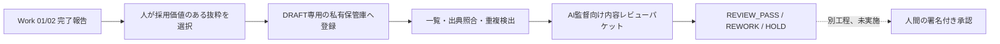

# ZCS-OS-014｜制作報告からDRAFT候補を蓄積する運用（隔離版）

本実装はStudio Memoryの**候補受付のみ**を追加する。Draft PR #8〜#11に依存する新しい隔離ブランチであり、既存PR、本番OS、MASTER、Readerの正式記憶保管庫は変更しない。実運用の秘密鍵・署名・登録は使わない。



## 既存機能との関係

- 候補の項目検証、出典からの原文抜粋、SHA-256、`DRAFT`の初期状態はZCS-OS-012の`build_candidate`を共用する。チャット履歴の自動収集はない。
- DRAFT専用保管庫は`candidates/`、`annotations/`、`reviews/`に分かれ、正式Markdown保管庫を参照するだけ。鍵・署名・登録機能は持たない。
- 登録ワークフローの`DIRECTOR_REVIEWED`と、AI監督の`REVIEW_PASS`等は別。AIレビューは候補の`workflow_status: DRAFT`と`approval_status: DRAFT`を変更しない。
- 関連記憶のID・表題・承認状態・範囲を読み取れる。表題、素材ID、人物名から保守的な重複候補を示すが、意味上の矛盾は人間が判断する。
- 既存ReaderにはDRAFT候補を配信しない。一般WorkのReaderトークンで候補を見せない。CLIは私有保管庫の所有者だけが実行する前提で、同じOSユーザー内の別Workに対する秘匿は保証しない。

## CLI（隔離環境）

実行場所は`backend`。すべてのパスはGit外の私有領域を使い、保管庫は0700、ファイルは0600にする。`<...>`は操作者が選んだ実パスであり、以下は実鍵操作ではない。

```text
python -m tools.memory_drafts --root <私有DRAFT領域> init --vault <既存記憶の読取先>
python -m tools.memory_drafts --root <私有DRAFT領域> add --report <完了報告> --fields <原文抜粋を選んだJSON> --unknowns <未確認事項JSON>
python -m tools.memory_drafts --root <私有DRAFT領域> list [--work work01|work02] [--character ユナ] [--asset K07] [--q キーワード]
python -m tools.memory_drafts --root <私有DRAFT領域> detail --id <候補ID>
python -m tools.memory_drafts --root <私有DRAFT領域> packet --id <候補ID> --out <私有パケットJSON>
python -m tools.memory_drafts --root <私有DRAFT領域> record-review --id <候補ID> --result REVIEW_HOLD --reviewer <評価者ラベル> --note <理由>
```

`--fields`は既存ワークフローと同じ必須項目を用いる。作品名と未確認事項はDRAFT注記に記録する。報告に存在しない判断・理由は推測せず、候補を作らないか`未確認`として扱う。出典ファイルの改変・欠落は一覧とパケットに表示され、`REVIEW_PASS`を拒否する。候補の承認範囲を後から直接書き換えると保存時のダイジェストとの不一致で読取を拒否する。

`record-review`はAIの**内容評価メモ**であり、署名者の本人認証ではない。`reviewer_label`の文字列だけで監督本人を証明できない。正式な人間署名経路へ渡す場合は、元報告を改めて照合し、ZCS-OS-012/013の候補・審査票を別途作成する。DRAFT保管庫からの自動昇格・移動はない。

## 日常制作での手順

1. Work 02が制作結果とQCを原文ファイルに残す。Work 01もOS開発・SNS・デザインの重要な判断を報告する。
2. Work 01が長期的な価値のある判断・修正理由・承認範囲だけを選び、原文一致の抜粋を記入する。作業完了ごとに必ず記憶を作るわけではない。
3. DRAFT専用CLIで追加し、`list`と`detail`で出典ハッシュ、未確認事項、関連記憶、重複候補を確認する。
4. `packet`をAI監督へ提示する。監督の内容レビューを`REVIEW_PASS`・`REVIEW_REWORK`・`REVIEW_HOLD`として記録する。これは署名承認ではない。
5. プロデューサー判断が必要な候補はDRAFTのまま待機。正式登録は鍵保管と本人確認の運用が承認された後に、独立した署名経路で行う。

## Work 02候補と既存記憶の関係

実候補`WORK02-EP00-R03-001`は、制作報告の技術QCと演出・作画QCの結果を別々に読めるようにする。`YUNA-EYE-001`は既存の目元に関する記憶であり、機械的には同じ人物の判断として重複候補になる。ただし、それぞれが指すr03の素材・工程・判断時点が同一とはまだ立証できない。**推奨は別IDのまま関連リンクを維持し、監督に意味上の重複を確認してもらうこと**。統合案は出典や判断範囲を混ぜるおそれがある。どちらの案も正式採用はしない。

## 隔離運用判定

**条件付き**。DRAFT候補の継続蓄積と監督用パケット作成は隔離環境で利用可能。正式登録・本番接続の運用開始は不可。理由は、ZCS-OS-013で残る署名者本人確認・同一macOSユーザーからの鍵隔離・鍵喪失復旧が未決であるため。Reader側の検索とWork別認証は維持されるが、候補CLIへのWork別認証や相互隔離はまだない。

## PR依存関係

`#8 OS閲覧 → #9 Reader/Work別認証 → #10 承認登録 → #11 鍵ID・失効 → 本変更 DRAFT受付`。これはコード依存でありマージ順序の提案に過ぎない。各PRはDraftを維持する。将来の統合前には、私有データの移行境界、権限、トランザクション復旧、複数管理者の同時操作を再評価する。
