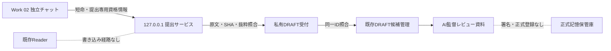

# ZCS-OS-015｜Work間DRAFT提出経路（隔離検証）

状態：DRAFT。既存PR #8〜#12、本番OS、正式記憶保管庫には反映しない。

## 方式比較

| 方式 | 接続・本人識別 | 改変・再送 | 運用と既存実装 | 判断 |
| --- | --- | --- | --- | --- |
| 専用ローカル提出API | 別Workから127.0.0.1へ接続可。Readerとは別の短命資格情報 | 原文SHA-256と原文抜粋を受領側で照合。受付IDで冪等化 | 既存FastAPIとDRAFT候補生成を再利用。起動中の管理が必要 | 隔離TEST採用 |
| 署名・ハッシュ付きファイル | 別チャット間で受け渡せるが署名鍵配布と回収が必要 | 署名・ハッシュを検証可能。再送と受付状態は追加設計が必要 | 同一macOSユーザー下の権限だけではWork隔離にならない | 将来のオフライン代替 |
| 専用ローカルキュー | 非同期再試行に適する | キュー状態と排他・破損復旧の追加実装が必要 | 現段階では構成が過大 | 保留 |

## 境界と状態

- 提出APIはReaderアプリへ組み込まない。明示的に起動し、127.0.0.1だけへバインドする。公開ポート転送を行わない。
- 提出トークンはReaderとは異なる鍵・audience・操作範囲を持つ。Work 02専用、最大15分。失効時には世代を更新する。プロデューサー・監督の署名鍵とは無関係。
- 通信本文には原文と候補フィールドを含める。リクエスト中にローカルから出ず、Gitや監査ログへ保存しない。元ファイルのパスは受け取らない。
- 受付イベントは`SUBMITTED → VALIDATED → READY_FOR_REVIEW`。検証失敗は`NEEDS_CORRECTION`、AI内容レビュー後は受付照会上`REVIEWED`。この状態は記憶の`approval_status=DRAFT`および`workflow_status=DRAFT`とは別。
- 同じ受付ID・同じ内容の再送は同じ結果を返す。同じ受付IDで内容が違えば拒否する。同じ候補IDが既存にある場合、判断・範囲・出典ハッシュが一致した場合だけ既存DRAFTへ紐づける。`proposed_by`は既存候補を保存し、受付側に認証済み提出元を別記録する。
- 受付後のWork 01確認はオフラインCLIで行い、監督レビュー資料には既存`memory_drafts.review_packet`を使う。AIレビューは`DIRECTOR_REVIEWED`署名ではない。
- 監査記録はUTC時刻、Work ID、操作、結果、受付IDのみ。資格情報、原文、抜粋を含めない。

## 試験用操作

同じMacの私有出力フォルダにDRAFT受付と別資格情報を配置し、`backend/tools/memory_submission.py`で初期化・発行・受領・失効する。資格情報ファイルは0600、受付ディレクトリは0700。Work 02は `submit` コマンドを実行し、原文コピーは受付側にだけ保存する。トークン本文を画面、チャット、Gitへ出さない。

## 限界

同一macOSユーザーで動作するWork間では、0700/0600だけで悪意ある他Workを完全に隔離できない。今回の認証は経路と失効の機能検証であり、別OSユーザーやハードウェア鍵と同等の本人保証ではない。別チャットの提出実績も、チャットの本人性を暗号学的に証明しない。正式運用前には別ユーザーまたは外部署名等の分離、TLS等の接続条件、常駐・復旧監視、受付と候補保存のトランザクション化が必要。
